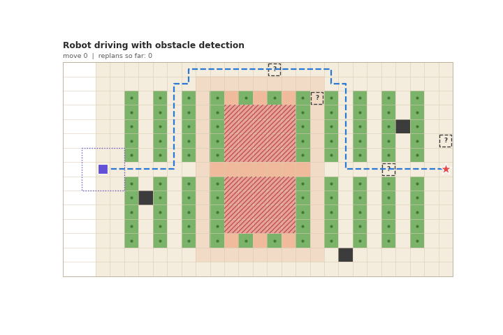
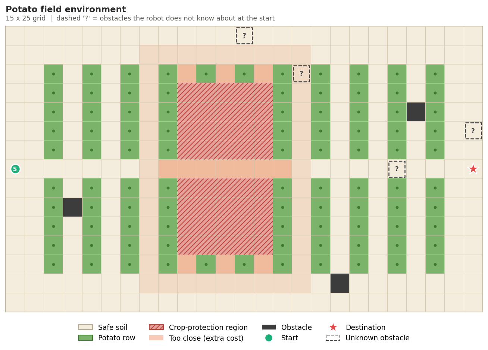
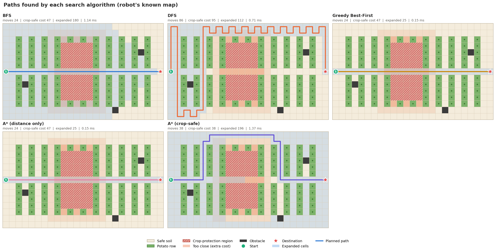
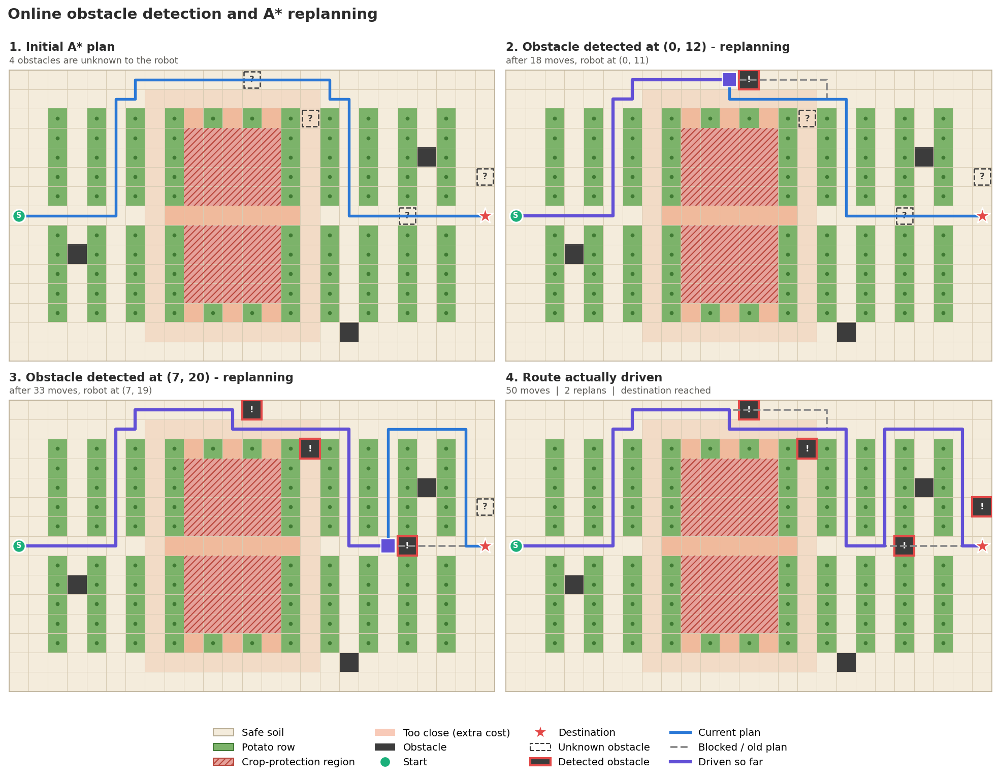

# AI-Based Crop-Safe Path Planning for an Autonomous Potato-Field Robot

Group coding assignment for the Artificial Intelligence course.

A robot has to drive across a potato field from a start cell to a destination
without driving over potato plants, without entering crop-protection regions,
and without hitting obstacles. The field is a 2D grid. We plan the route with
four search algorithms (BFS, DFS, Greedy Best-First, A*), add a cost penalty
so the robot keeps a safe distance from protected crops, and simulate obstacles
that the robot only discovers while driving, so it has to replan with A*.



---

## How to run

Requires **Python 3.9+** with **NumPy** and **Matplotlib**.

```bash
pip install -r requirements.txt
python main.py            # runs every task, prints tables, saves figures to outputs/
python main.py --show     # same, and also opens the figures in windows
python main.py --no-gif   # skip the animation (a bit faster)

python -m unittest discover tests   # run the tests
```

### Live demo (for the presentation)

```bash
python demo.py              # step-by-step demo in one window
python demo.py --stage 5    # jump straight to a stage (1-6)
```

The demo walks through the assignment one task at a time:

| Stage | Shows |
|---|---|
| 1 | The field: potato rows, protected regions, known and hidden obstacles |
| 2 | Problem formulation, with allowed / blocked moves drawn on the map |
| 3 | A live race: BFS, DFS, Greedy and A* expanding cells side by side |
| 4 | Shortest A* vs crop-safe A*, with the penalty written in every cell |
| 5 | The robot driving, detecting hidden obstacles and replanning with A*. **Click any free cell to drop a new obstacle** and the robot has to find it and replan. |
| 6 | The comparison tables (including the live run from stage 5) |

Controls: `->` / `<-` next / previous stage, `r` replay, `p` pause,
`+` / `-` speed, `q` quit. The on-screen buttons do the same.

## Project structure

```
main.py                    runs all tasks in order and saves the outputs
demo.py                    interactive step-by-step demo for presenting
cropsafe/
  field.py                 Task 1 - field grid, cell types, map layout
  problem.py               Task 2 - states, actions, transition, goal test, path cost
  uninformed.py            Task 3 - Breadth-First Search, Depth-First Search
  informed.py              Task 3 - Greedy Best-First, A*, Manhattan heuristic
  search_result.py         shared result object, path rebuilding, timing
  crop_safety.py           Task 4 - "too close to protected crops" penalty
  replanning.py            Task 5 - sensing, map update, A* replanning
  evaluation.py            Task 6 - runs the experiments, builds the tables
  visualize.py             all figures and the animation
tests/test_planning.py     unit tests
outputs/                   screenshots, GIF and results.md (created by main.py)
```

---

## Task 1 - Field environment

The field is a 15 x 25 grid written as text in [cropsafe/field.py](cropsafe/field.py),
so it is easy to read and change:

| Symbol | Meaning | Can the robot enter? |
|---|---|---|
| `.` | safe soil (lanes between rows, headlands at the edges) | yes |
| `P` | potato row | no |
| `X` | crop-protection region (e.g. diseased or seedling patch) | no |
| `#` | obstacle known in advance (stone, tool) | no |
| `?` | obstacle the robot does **not** know about at the start | no (once found) |
| `S` / `G` | start / destination | yes |

Potato rows run vertically with driving lanes between them. Row 7 is a
cross path through the middle of the field, and it runs right between two
crop-protection regions.



## Task 2 - Problem formulation

| Part | Definition |
|---|---|
| **State** | the robot's cell `(row, col)` |
| **Initial state** | the start cell `S` = (7, 0) |
| **Actions** | `Up`, `Down`, `Left`, `Right` (4-connected, no diagonal moves). An action is only allowed if the new cell is inside the field and is not a potato, protected or known obstacle cell. |
| **Transition model** | `result((r, c), a) = (r + dr, c + dc)` e.g. `Up` = (-1, 0) |
| **Goal test** | `state == G` = (7, 24) |
| **Path cost** | sum of step costs. A move into cell *n* costs `1 + penalty(n)` (see Task 4). Without the crop-safe option every move costs 1. |

Diagonal moves are not allowed because a diagonal move between two potato
rows would clip the corners of the plants.

## Task 3 - Search algorithms

All four are **graph searches** (a cell is never expanded twice).
"Nodes expanded" = number of cells taken off the frontier.

| Algorithm | Frontier | Uses cost? | Uses heuristic? | Optimal? |
|---|---|---|---|---|
| BFS | FIFO queue | no | no | fewest moves only |
| DFS | LIFO stack | no | no | no |
| Greedy Best-First | priority queue on `h(n)` | no | yes | no |
| A* | priority queue on `f(n) = g(n) + h(n)` | yes | yes | yes (cheapest cost) |

### Heuristic

Both informed searches use the **Manhattan distance**:

```
h(n) = |row(n) - row(G)| + |col(n) - col(G)|
```

* The robot moves only in 4 directions, so it needs at least `h(n)` moves to
  reach the goal even if the field were empty.
* Every move costs **at least 1** (penalties only add cost).
* So `h(n)` never overestimates the real remaining cost: it is **admissible**.
* One move changes `h` by at most 1 while costing at least 1, so
  `h(n) <= cost(n, n') + h(n')`: it is also **consistent**.

Because of this, A* is guaranteed to return the cheapest path.
Greedy Best-First uses only `h(n)` and ignores the cost already paid, so it is
fast but gives no guarantee about the path it returns.



Light blue cells are the cells each algorithm expanded.

## Task 4 - Crop-safe planning

* **Hard rule:** potato, protected and obstacle cells are never offered as
  actions, so no algorithm can enter them.
* **Soft rule:** cells close to a crop-protection region are allowed but cost
  extra ([cropsafe/crop_safety.py](cropsafe/crop_safety.py)):

| Distance to nearest protected cell (incl. diagonals) | Extra cost per move |
|---|---|
| 1 (touching) | +3 |
| 2 (one cell gap) | +1 |
| 3 or more | 0 |

These cells are shaded orange in the figures. The shortest route goes straight
along the middle cross path, squeezed between both protected regions
(24 moves, cost 47). Crop-safe A* instead takes a detour along the top
headland (38 moves, cost 38) that never enters the "too close" zone.
If no safe detour existed, A* would still use the close cells, because they
are only penalised, not forbidden.

## Task 5 - Obstacle detection and replanning

The field contains four obstacles (`?`) that the robot does not know about.
The robot keeps its own **known map** in which they look like free soil
([cropsafe/replanning.py](cropsafe/replanning.py)).

At every step the robot:

1. **Senses** the 8 cells around it (sensor range 1) on the true field.
2. **Updates** its known map with any obstacle it did not know about.
3. **Checks** whether a newly found obstacle lies on its remaining route.
4. **Replans** with crop-safe A* from its current cell if the route is blocked.
5. **Moves** one step along the route.

In the run below the robot detects 4 hidden obstacles. Two of them block its
route, so it replans twice; the other two are noted on the map but no replan
is needed.

```
move  18: detected obstacle at (0, 12)  (route blocked -> A* replans)
move  22: detected obstacle at (2, 15)  (not on route, keep going)
move  33: detected obstacle at (7, 20)  (route blocked -> A* replans)
move  46: detected obstacle at (5, 24)  (not on route, keep going)
Destination reached: True after 50 moves
```



## Task 6 - Performance evaluation

Time is the median of 25 runs and changes from machine to machine.
"Crop-safe cost" scores every path with the same rule, so the algorithms can be
compared fairly. "Near-crop cells" counts path cells in the orange zone.

**Search algorithms (robot's known map)**

| Algorithm | Reached | Path length | Crop-safe cost | Near-crop cells | Nodes expanded | Time (ms) |
|---|---|---|---|---|---|---|
| BFS | Yes | 24 | 47 | 9 | 180 | 1.142 |
| DFS | Yes | 86 | 95 | 9 | 112 | 0.708 |
| Greedy Best-First | Yes | 24 | 47 | 9 | 25 | 0.153 |
| A* (distance only) | Yes | 24 | 47 | 9 | 25 | 0.149 |
| A* (crop-safe) | Yes | 38 | 38 | 0 | 196 | 1.374 |

**Online obstacle experiment**

| Strategy | Reached | Path length | Crop-safe cost | Nodes expanded | Time (ms) | Obstacles detected | Replans |
|---|---|---|---|---|---|---|---|
| A* + online replanning | Yes | 50 | 55 | 326 | 7.582 | 4 | 2 |
| A* with full map (reference) | Yes | 38 | 38 | 149 | 1.047 | - | 0 |

The online time also includes sensing and recording the animation frames.

### Observations

* **BFS** finds the path with the fewest moves (24) but expands 180 cells,
  because it spreads out evenly in all directions. It does not look at cost,
  so its route squeezes between the protected regions.
* **DFS** reaches the goal but its path is 86 moves long: it follows one
  direction as deep as possible and zig-zags along the headlands. It is not a
  good choice for path planning.
* **Greedy Best-First** is the fastest (25 cells expanded) because the
  heuristic pulls it straight to the goal along the open cross path. Here it
  happens to be shortest, but it ignores crop safety and has no optimality
  guarantee.
* **A* (distance only)** gives the same short route with the same small
  effort, and it is guaranteed to be shortest.
* **A* (crop-safe)** is the only route with **0 cells near protected crops**
  and the lowest crop-safe cost (38 vs 47). It costs 14 extra moves and
  expands more cells, because the penalties make it explore other routes
  before it is sure the detour is cheapest. This is the trade-off we want for
  a crop-safe robot.
* **Online replanning:** with incomplete knowledge the robot still reaches
  the goal. It needed 2 replans and drove 50 moves (cost 55) instead of the 38
  it would drive if it had known every obstacle beforehand. Replanning is only
  done when the route is actually blocked, which saves computation.

All figures are in [outputs/](outputs/) and the tables are also saved in
[outputs/results.md](outputs/results.md).

---

## Group members and contributions

The code was written together; every member is responsible for explaining
the part listed below and should be able to explain the overall approach.

| Member | Roll number | Responsibility | Main files |
|---|---|---|---|
| Nakul Bhadade | BT24CSA047 | Field environment design, problem formulation, field visualisation (Tasks 1, 2) | `field.py`, `problem.py`, `draw_field` in `visualize.py` |
| Siddhi Dhooke | BT24CSA050 | BFS and DFS implementation, performance comparison tables and testing (Tasks 3, 6) | `uninformed.py`, `search_result.py`, `evaluation.py`, `tests/` |
| Pranjal Baghel | BT24CSA052 | Greedy Best-First Search and heuristic design / admissibility (Task 3) | `informed.py` (greedy, `manhattan`) |
| Ness Dubey | BT24CSA053 | A* implementation and crop-safe path cost (Tasks 3, 4) | `informed.py` (A*), `crop_safety.py` |
| Lakshuki Hatwar | BT24CSA063 | Obstacle detection simulation, map update and replanning, replanning animation (Task 5) | `replanning.py`, replanning plots in `visualize.py` |

## References

* S. Russell and P. Norvig, *Artificial Intelligence: A Modern Approach*,
  4th ed. - search algorithms, heuristics, admissibility and consistency.
* NumPy and Matplotlib documentation.
